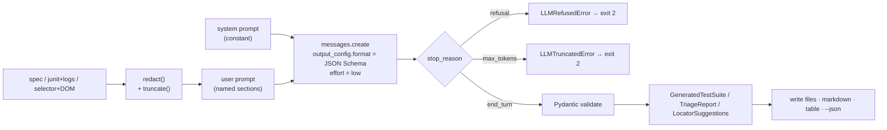

# ai-test-architect

[](https://github.com/yassineaitt/ai-test-architect/actions/workflows/ci.yml)
[](https://yassineaitt.github.io/ai-test-architect/htmlcov/index.html)
[](pyproject.toml)
[](https://github.com/astral-sh/ruff)
[](pyproject.toml)
[](LICENSE)

A CLI that puts Claude to work on the three chores that eat a test team's week:

| Command    | Input                                   | Output                                                        |
| ---------- | --------------------------------------- | ------------------------------------------------------------- |
| `generate` | OpenAPI 3 spec                          | A runnable pytest + httpx API suite, one module per tag       |
| `triage`   | JUnit XML + log files from a failed run | Root cause, category, calibrated confidence, proposed fix     |
| `heal`     | A broken Playwright selector + DOM      | Ranked replacement locators (test id → role → label → text)   |

Every command is **inspectable without an API key** (`--dry-run` prints the exact prompt),
**safe by default** (credentials are scrubbed before anything leaves the machine) and
**typed end to end** (the model is constrained to a JSON Schema and the result is validated
with Pydantic before it is used).

## Install

```bash
uv tool install git+https://github.com/yassineaitt/ai-test-architect   # or: pipx install git+...
export ANTHROPIC_API_KEY=...                                             # or `ant auth login`
ai-test-architect --help
```

Or from a checkout: `uv sync && uv run ai-test-architect --help`.

## Usage

### Generate pytest API tests from an OpenAPI spec

```bash
ai-test-architect generate examples/openapi/petstore.yaml --out generated-tests --tag pets
API_BASE_URL=https://petshelter.example.com/api/v1 pytest generated-tests
```

Produces `tests/test_<tag>.py` modules plus a `tests/conftest.py` with an `httpx.Client`
fixture (base URL and optional bearer token from the environment). Generated files are
compiled with `ast.parse` before anything is written; the command exits 3 instead of leaving
broken files behind.

### Triage a failed run

```bash
ai-test-architect triage reports/junit.xml --log logs/app.log --out triage.md
```

```markdown
## Test failure triage
**Summary:** The adoption endpoint 500s because the `adoption_requests` table was never created.
**Category:** `environment` · **Confidence:** 90%
### Evidence
- `relation "adoption_requests" does not exist`
- `migration runner skipped: MIGRATIONS_ENABLED=false`
### Suggested fix
**Target:** `deploy/env` …
```

`--json` gives the same report as machine-readable JSON for bots and dashboards. Logs are
tailed (`--tail 400`) and redacted; the example log in `examples/triage/` contains a fake
password and a fake JWT precisely to show that.

### Heal a broken Playwright locator

```bash
ai-test-architect heal "#submit-btn" --dom snapshot.html --context failure.txt
```

```
Likely cause: the submit button lost its id in the design-system migration
┏━━━━━━━━━━━━┳━━━━━━━━━━┳━━━━━━━━━━━━━━━━━━━━━━━━━━━━━━━━━━━━━━━━━━━━━━━━━━━━┳━━━━━━━━━━━━━━━━━━━━━━━━━━━━┓
┃ confidence ┃ strategy ┃ locator                                            ┃ why                        ┃
┡━━━━━━━━━━━━╇━━━━━━━━━━╇━━━━━━━━━━━━━━━━━━━━━━━━━━━━━━━━━━━━━━━━━━━━━━━━━━━━╇━━━━━━━━━━━━━━━━━━━━━━━━━━━━┩
│        95% │ test-id  │ page.getByTestId('submit-adoption')                │ unique data-testid         │
│        90% │ role     │ page.getByRole('button', { name: 'Send request' }) │ unique accessible name     │
└────────────┴──────────┴────────────────────────────────────────────────────┴────────────────────────────┘
```

Exit code 4 means the element is gone from the DOM (so the test, not the locator, needs
attention). Grab a snapshot in Playwright with `await page.content()`.

### Common flags

| Flag              | Default             | Notes                                                       |
| ----------------- | ------------------- | ----------------------------------------------------------- |
| `--model`         | `claude-sonnet-5-5` | Any model with structured outputs; env `AI_TEST_ARCHITECT_MODEL` |
| `--effort`        | `low`               | `low` / `medium` / `high` - the determinism and cost knob   |
| `--max-tokens`    | `16000`             | Response budget                                             |
| `--dry-run`       | off                 | Print the redacted prompt and exit (no key needed)          |
| `--json`          | off                 | Validated result as JSON                                    |

## How it works



The design rationale (why low effort instead of temperature, why schemas are kept plain,
how redaction works, what happens on refusal) is in **[docs/prompt-design.md](docs/prompt-design.md)**.

## Quality

- `ruff` (strict rule set) and `mypy --strict`, enforced by pre-commit and CI.
- `pytest` with a **≥ 85 % coverage gate**; the badge above is generated from the latest
  `main` run and published to GitHub Pages together with the HTML report.
- **No network in tests.** Commands are tested against a `FakeLLM`; the Anthropic client is
  tested against an `httpx2.MockTransport` that replays real Messages API JSON, including
  refusal and truncation responses. CI runs with `ANTHROPIC_API_KEY=""` on Linux, macOS and
  Windows to prove it.
- Conventional Commits, Dependabot for `uv` and Actions.

## Project layout

```
src/ai_test_architect/
├── cli.py              Typer app: generate · triage · heal
├── config.py           Settings (model, effort, budgets) from flags/env
├── redaction.py        credential scrubbing + size bounding
├── schemas.py          Pydantic output contracts
├── llm/                client.py (structured call, stop-reason guards) · prompts.py
├── generate/           openapi.py (load/validate/digest) · writer.py (safe writes, conftest)
├── triage/             inputs.py (JUnit + logs) · report.py (Markdown)
└── heal/               dom.py (DOM → locator-relevant summary)
examples/               petstore.yaml · junit.xml + app.log · page.html + context.md
docs/prompt-design.md   prompt and guardrail rationale
tests/                  46 tests, API mocked
```

## License

[MIT](LICENSE) © Yassine Ait Tamarmoucht
